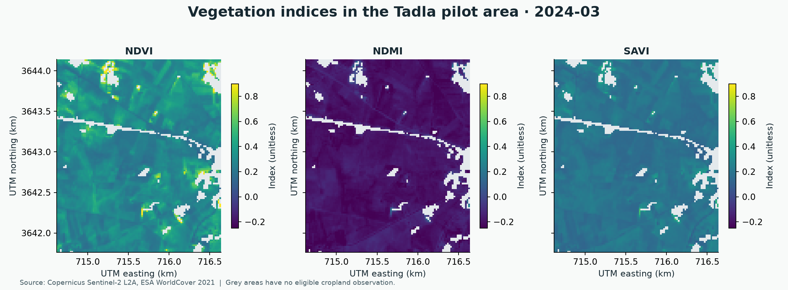
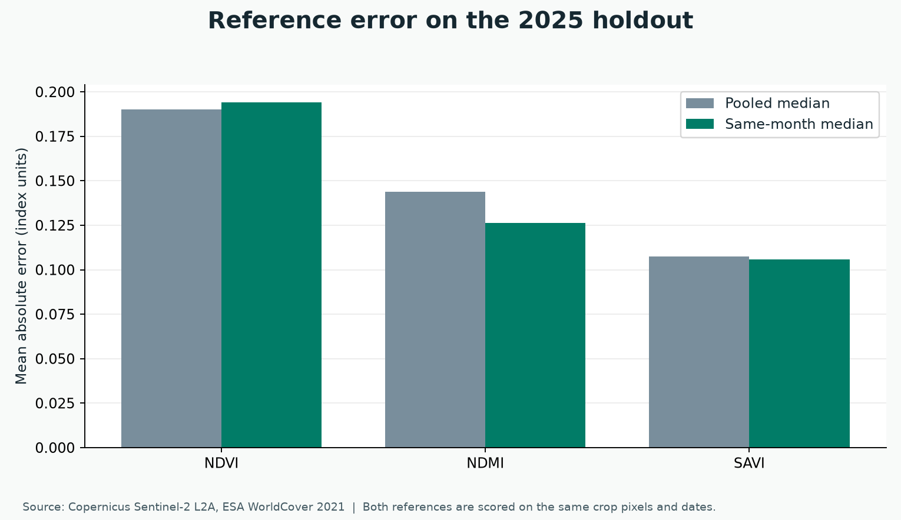
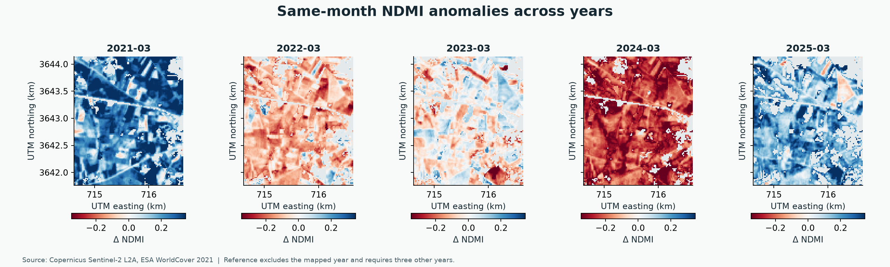
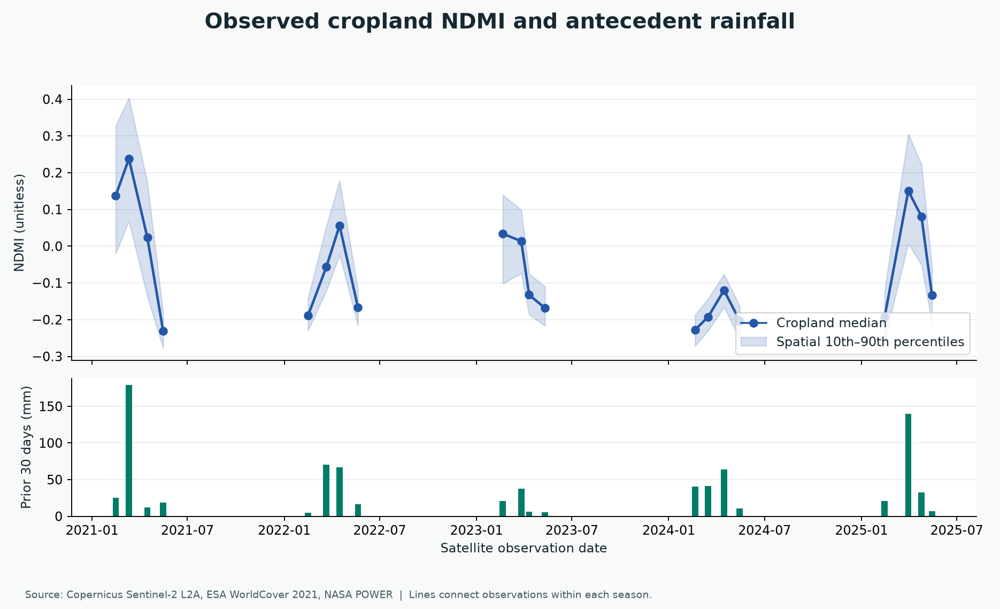
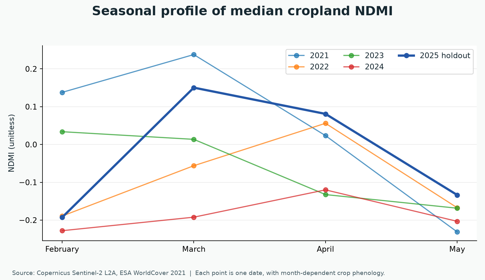
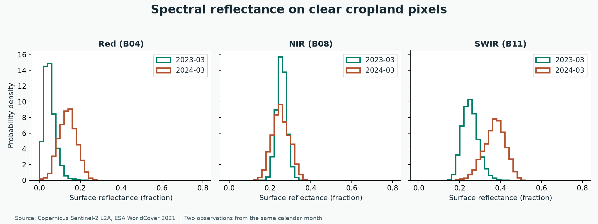
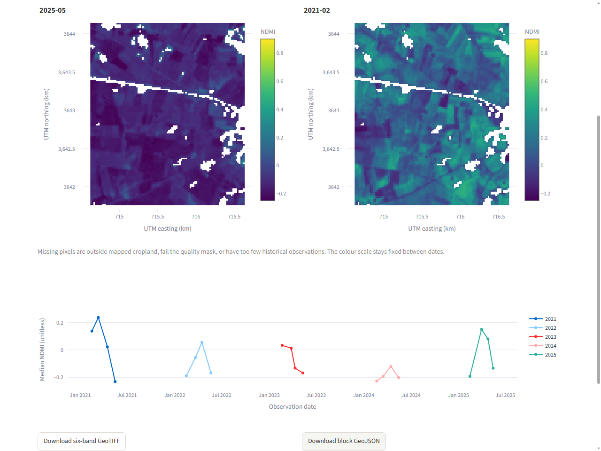

# Satellite-Based Agricultural Drought Monitoring

This monitor maps vegetation indices and seasonal spectral anomalies over a 4.8 km² pilot grid in the Tadla plain, Morocco. An analyst can compare two observations, inspect NDVI, NDMI and SAVI, and download the corresponding raster or block statistics.



## Data and method

The study uses 20 Sentinel-2 L2A observations, one per month from February to May during 2021–2025. The [source manifest](data/source-manifest.json) pins scene IDs, asset URLs, scales, offsets and window hashes. Contains modified Copernicus Sentinel data 2021–2025. The scenes come from [Earth Search](https://github.com/Element84/earth-search/blob/main/docs/collections/sentinel-2-l2a.md) under the [Copernicus terms](https://dataspace.copernicus.eu/terms-and-conditions).

© ESA WorldCover project 2021 / Contains modified Copernicus Sentinel data (2021) processed by ESA WorldCover consortium. [WorldCover 2021](https://esa-worldcover.org/en/data-access), under CC BY 4.0, identifies 11,265 mapped cropland cells. [NASA POWER PRECTOTCORR](https://power.larc.nasa.gov/docs/services/api/temporal/daily/) supplies MERRA-2 precipitation for the nearest regional grid cell. Rainfall totals use the 30 calendar days before the image date.

Rasterio reads small cloud-optimized windows on a 20 m UTM grid. Red and NIR are aggregated from 10 m using averaging. SWIR is native 20 m. The workflow keeps SCL classes 4 and 5 and filters non-finite or negative inputs and zero reflectance denominators. It prefers images near the 15th with at least 85% usable cropland. If none meet that criterion it takes the best available image above 80%. Only March 2025 used that fallback, with 81.5% usable support.

The same-month median for a pixel excludes the year being assessed and requires at least three other valid observations. The benchmark compares it with a month-agnostic per-pixel median, fitted on 2021–2024 and scored on the same valid pixel-month pairs in 2025. The exports contain the three indices and their anomalies. The GeoJSON aggregates statistics by approximate 400 m blocks in WGS 84 and includes support counts.

## Measured results

| Index | Same-month MAE | Pooled MAE | Comparable test pixel-month pairs |
| --- | ---: | ---: | ---: |
| NDVI | 0.1942 | 0.1901 | 40,742 |
| NDMI | 0.1261 | 0.1438 | 40,742 |
| SAVI | 0.1056 | 0.1074 | 40,742 |

Seasonal matching reduced NDMI MAE by 12.3% in 2025. The weakest median NDMI anomaly was −0.256 in March 2024. The preceding 30-day rainfall estimate was 41.23 mm. The rank correlation between rainfall and NDMI anomalies was 0.367 across 20 observations. These monthly observations are dependent. No causal rainfall effect is estimated.

- The [time series](reports/figures/ndmi-precipitation-series.png) places NDMI and historical rainfall on aligned dates.
- The [same-month anomaly maps](reports/figures/ndmi-anomaly-maps.png) show spatial support and between-year variation.
- The [spectral histograms](reports/figures/spectral-distributions.png) compare the reflectance behind the NDMI shift.
- The [seasonal profiles](reports/figures/seasonal-comparison.png) show the path from February to May by year.
- The [holdout benchmark](reports/figures/heldout-reference-benchmark.png) shows which indices benefit from a monthly reference.

## Reproduce

~~~powershell
python -m pip install -r requirements.txt
python acquire.py
python analyze.py
python -m pytest -q
python -m streamlit run dashboard.py
~~~

The workflow uses CPU and local cached inputs after acquisition. [Machine-readable metrics](reports/metrics.json) accompany the figures. Inspect the held-out comparison in [the analysis notebook](notebooks/analysis.ipynb) from the project root after generating the outputs. [Dashboard capture](reports/figures/dashboard.png)

A single scene per month can miss short events. The study uses a static cropland mask and a historical reference of at most four comparable years. Irrigation, cropping calendars, harvest and residual cloud affect the indices. Soil moisture or field measurements would be needed to interpret the spectral signal as crop water stress.

<!-- RELEASE-GALLERY -->

## Architecture and technologies

Earth Search COG windows, Rasterio quality masks and historical indices feed Plotly maps and a Streamlit time-series view.

## Visualizations












[Executed notebook](notebooks/analysis.ipynb) · [Evaluation metrics](reports/metrics.json) · [Local QA](reports/QA.md)

## Application demo

```text
python -m streamlit run dashboard.py
```



## Future improvements

Use an independent field moisture network to validate remote anomalies and extend the study beyond the four seasonal months.
